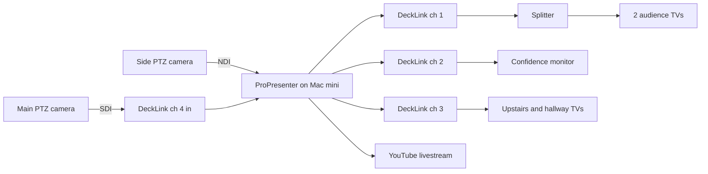

ProPresenter on the Mac mini is the center of the video system. Everything goes in and out through a Blackmagic DeckLink Duo 2 (four SDI channels, in a Thunderbolt enclosure), plus one camera over the network. All video is run over SDI.

| DeckLink channel | Direction | Goes to |
|---|---|---|
| 1 | Out | Audience TVs, through a splitter |
| 2 | Out | Confidence monitor, back of room |
| 3 | Out | Upstairs and hallway TVs |
| 4 | In | Main PTZ camera |

The side camera isn't on the DeckLink. It comes in over NDI on the network.

## No picture?

See [[troubleshooting#No picture on a screen|No picture on a screen]].
